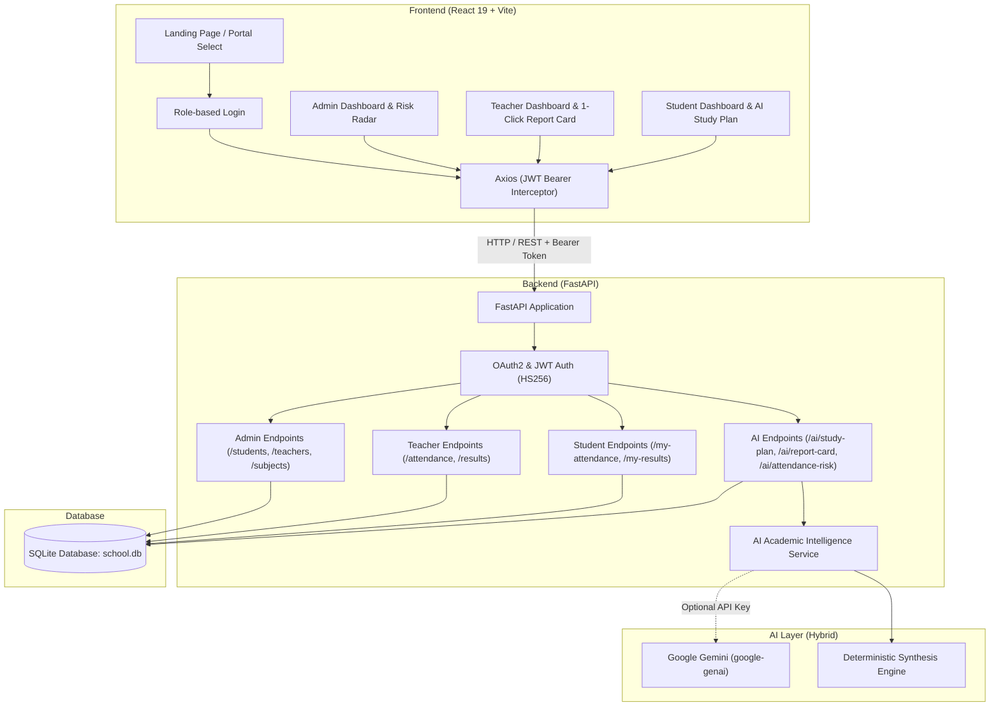
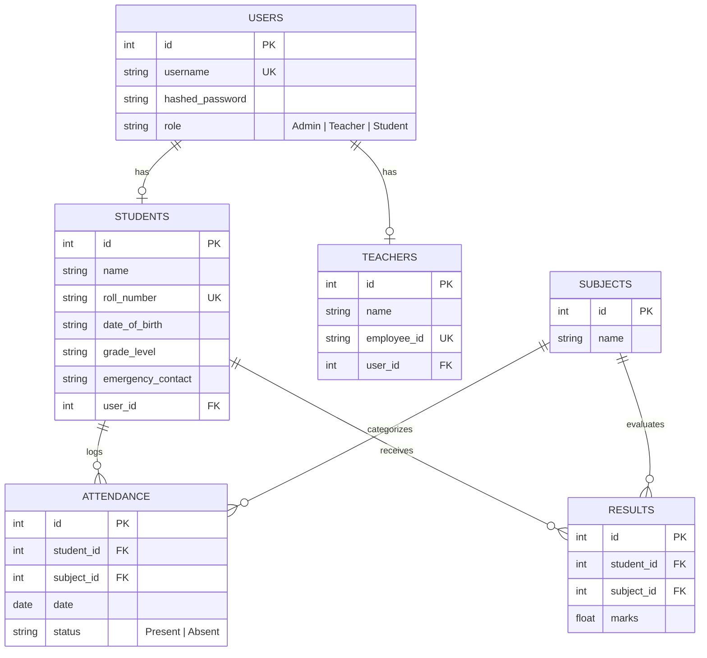

# 🎓 EduCore — School Management & AI Academic Intelligence Platform

[](https://fastapi.tiangolo.com/)
[](https://react.dev/)
[](https://vitejs.dev/)
[](https://tailwindcss.com/)
[](https://ai.google.dev/)
[](https://www.sqlite.org/)
[](https://opensource.org/licenses/MIT)

> **EduCore** is a modern, responsive, full-stack school management platform augmented with an **AI Academic Intelligence Engine**. It streamlines administrative workflows, equips teachers with 1-click AI evaluation generators, and empowers students with automated study schedules and real-time attendance risk early warnings.

---

## 📌 Table of Contents

- [Overview](#-overview)
- [🤖 AI Academic Intelligence Suite](#-ai-academic-intelligence-suite)
  - [1. Attendance Risk Early Warning System](#1-attendance-risk-early-warning-system)
  - [2. Automated Study Plan & Weakness Diagnostic](#2-automated-study-plan--weakness-diagnostic)
  - [3. 1-Click AI Report Card & Feedback Generator](#3-1-click-ai-report-card--feedback-generator)
- [Key Features](#-key-features)
  - [🛡️ Admin Portal](#️-admin-portal)
  - [👨‍🏫 Teacher Portal](#-teacher-portal)
  - [🎓 Student Portal](#-student-portal)
- [System Architecture](#-system-architecture)
- [Database Schema](#-database-schema)
- [Tech Stack](#-tech-stack)
- [Directory Structure](#-directory-structure)
- [Quick Start Guide](#-quick-start-guide)
  - [Prerequisites](#prerequisites)
  - [1. Backend Setup](#1-backend-setup)
  - [2. Frontend Setup](#2-frontend-setup)
- [Default Credentials](#-default-credentials)
- [API Reference](#-api-reference)
- [CSV Bulk Ingestion Formats](#-csv-bulk-ingestion-formats)
- [Production Deployment](#-production-deployment)
- [Contributing](#-contributing)
- [License](#-license)

---

## 🌟 Overview

EduCore simplifies educational institution operations with a decoupled architecture:
- **FastAPI Backend**: Delivers high-performance REST APIs, native bcrypt password security, OAuth2 password authentication with JWTs, and SQLite database persistence via SQLAlchemy ORM.
- **AI Academic Intelligence Engine**: Integrated hybrid intelligence combining mathematical predictive models with Google Gemini (`google-genai`) and deterministic fallbacks.
- **React Frontend**: Built on React 19, Vite, and Tailwind CSS v4, featuring a dark glassmorphic design, smooth Framer Motion animations, interactive dashboards, and client-side route guards.

---

## 🤖 AI Academic Intelligence Suite

### 1. Attendance Risk Early Warning System
A mathematical and predictive analytics engine benchmarking student attendance against the mandatory **75.0% institutional cutoff**:
- **Risk Categorization**:
  - 🟢 **Safe Standing (≥80%)**: Computes margin of safety: how many consecutive classes a student can miss without dropping below 75%.
  - 🟡 **Caution Borderline (75.0% – 79.9%)**: Identifies students at immediate threshold boundary.
  - 🔴 **Critical Debarment Risk (<75.0%)**: Calculates the exact number of consecutive classes ($C \ge \lceil 3N - 4A \rceil$) the student must attend without absence to regain exam eligibility.
- **Subject-by-Subject Risk Breakdown**: Pins down courses where attendance is lagging.
- **AI Remediation Steps**: Produces tailored action items for both the student and class coordinator.

### 2. Automated Study Plan & Weakness Diagnostic
Analyzes recorded test scores and subject-level attendance correlations:
- **Academic Diagnostic**: Categorizes subjects into **Strengths** ($\ge 80$), **Moderate** ($60-79$), and **Priority Weak Areas** ($< 60$).
- **7-Day Dynamic Revision Schedule**: Generates a customized Monday-to-Sunday study plan with weighted study hours and specific daily revision tasks for high-priority subjects.
- **Cognitive Study Tactics**: Contextual learning strategies including the Pomodoro technique, Active Recall, Spaced Repetition, and the Feynman method.

### 3. 1-Click AI Report Card & Feedback Generator
Enables teachers and administrators to instantly synthesize a student's full academic semester:
- **Executive Teacher Narrative**: Generates formal, multi-paragraph evaluative feedback reflecting work ethic and performance.
- **Subject-Specific Observations**: Individual comments for each enrolled course.
- **Conduct & Punctuality Rating**: Evaluates institutional engagement based on attendance consistency.
- **Parent Recommendations & Student Targets**: Concrete home study advice and growth goals.
- **Export & Print Ready**: Clean, printable layout with standard letter grades (A+, A, B+, B, C, D, F).

---

## ✨ Key Features

### 🛡️ Admin Portal
- **Dashboard Overview**: Live institutional metrics (total students, faculty, courses, attendance logs, and graded results).
- **Attendance Risk Radar**: At-a-glance dashboard monitoring students across Critical (<75%), Caution (75-80%), and Safe (≥80%) risk tiers.
- **Student Management**: Full CRUD operations with roll numbers, DOB, grade levels, and emergency contacts.
- **Teacher Management**: Complete faculty directory with unique employee IDs and linked user credentials.
- **Subject Management**: Curriculum catalog administration for all academic courses.
- **Bulk CSV Ingestion**: High-throughput CSV uploads for batch enrolling students and importing attendance sheets.

### 👨‍🏫 Teacher Portal
- **Classroom Roster & Risk Badges**: Real-time view of student attendance risk status and attendance percentages.
- **One-Click Attendance**: Mark daily attendance (`Present` / `Absent`) with automatic timestamps and subject tagging.
- **Grade & Marks Upload**: Record student exam and evaluation scores (out of 100) per subject.
- **1-Click AI Report Card**: Modal to generate, view, edit, and print official student evaluations.

### 🎓 Student Portal
- **Attendance Early Warning Widget**: Visual risk gauge, current percentage, margin of safety / classes needed, and remediation guidelines.
- **AI Weekly Study Plan Tab**: Complete 7-day revision schedule with focus areas and allocated study hours.
- **Official AI Report Card Tab**: View, print, and export official academic evaluation letters.
- **Academic Scorecard**: Real-time breakdown of examination scores across all enrolled subjects.

---

## 🏗️ System Architecture



---

## 🗄️ Database Schema



---

## 💻 Tech Stack

| Domain | Technology | Description |
|---|---|---|
| **Frontend Framework** | React 19 | Declarative UI library |
| **Build Tool** | Vite 8 | Ultra-fast HMR and bundle optimization |
| **Styling** | Tailwind CSS v4 + PostCSS | Modern utility-first CSS design |
| **Animations** | Framer Motion | Fluid spring physics and route transitions |
| **Routing** | React Router DOM v7 | Dynamic client-side routing & nested views |
| **Icons** | React Icons & Lucide React | High-quality vector icon sets |
| **Backend API** | FastAPI | High-performance Python async web framework |
| **ORM** | SQLAlchemy | Object-relational database mapping |
| **Database** | SQLite | Lightweight embedded SQL database |
| **AI Engine** | Google Gemini (`google-genai`) + Heuristic Engine | Generative academic evaluations & risk modeling |
| **Security** | Direct Bcrypt + OAuth2 + JWT (HS256) | Robust password hashing and token security |
| **Server** | Uvicorn | Lightning-fast ASGI web server |

---

## 📁 Directory Structure

```text
School-management-system/
├── backend/
│   ├── ai_service.py        # AI Academic Intelligence (Risk, Study Plan, Report Card)
│   ├── auth.py              # JWT tokens, bcrypt password hashing & authentication
│   ├── database.py          # SQLAlchemy engine, session maker & SQLite connection
│   ├── db_test.py           # Database verification script
│   ├── main.py              # FastAPI app, CORS, routes & AI endpoints
│   ├── models.py            # SQLAlchemy database models
│   ├── requirements.txt     # Python backend dependencies
│   └── schemas.py           # Pydantic schemas for request validation & serialization
├── frontend/
│   ├── public/              # Static assets, SVG icons & routing redirects
│   ├── src/
│   │   ├── assets/          # Project graphics and SVG badges
│   │   ├── components/      # Reusable components (DashboardLayout)
│   │   ├── pages/           # Application views
│   │   │   ├── admin/       # Admin views (Overview, Students, Teachers, Subjects, Attendance)
│   │   │   ├── AdminDashboard.jsx
│   │   │   ├── Home.jsx             # Interactive landing & portal selector
│   │   │   ├── Login.jsx            # Dynamic role-based login screen
│   │   │   ├── StudentDashboard.jsx # Student portal with AI Study Plan & Risk Warning
│   │   │   └── TeacherDashboard.jsx # Teacher portal with 1-Click AI Report Card
│   │   ├── utils/
│   │   │   └── api.js       # Dynamic Axios client with JWT interceptor
│   │   ├── App.css          # Core animations & styling
│   │   ├── App.jsx          # Route declarations
│   │   ├── index.css        # Tailwind CSS imports
│   │   └── main.jsx         # React application root
│   ├── package.json         # Frontend dependencies and npm scripts
│   ├── tailwind.config.js   # Tailwind design configuration
│   └── vite.config.js       # Vite build configuration
└── README.md                # Project documentation
```

---

## 🚀 Quick Start Guide

### Prerequisites
- **Python**: Version `3.10` or higher
- **Node.js**: Version `18.x` or higher
- **npm** or **yarn**

---

### 1. Backend Setup

1. **Navigate to the backend directory**:
   ```bash
   cd backend
   ```

2. **Create and activate a virtual environment**:
   - On Windows (PowerShell):
     ```powershell
     python -m venv venv
     .\venv\Scripts\Activate.ps1
     ```
   - On macOS/Linux:
     ```bash
     python3 -m venv venv
     source venv/bin/activate
     ```

3. **Install dependencies**:
   ```bash
   pip install -r requirements.txt
   ```

4. *(Optional)* **Configure Google Gemini API Key**:
   Create a `.env` file in the `backend/` directory:
   ```env
   GEMINI_API_KEY=your_actual_gemini_api_key_here
   ```
   > 💡 *Note*: If `GEMINI_API_KEY` is not provided, the built-in deterministic academic intelligence engine runs automatically with 100% functionality and accuracy.

5. **Run the backend server**:
   ```bash
   uvicorn main:app --reload --host 0.0.0.0 --port 8000
   ```
   > 💡 The API will start at **http://localhost:8000**.
   > Interactive API documentation (Swagger UI) is available at **http://localhost:8000/docs**.

---

### 2. Frontend Setup

1. **Open a new terminal and navigate to the frontend directory**:
   ```bash
   cd frontend
   ```

2. **Install npm packages**:
   ```bash
   npm install
   ```

3. **Launch the development server**:
   ```bash
   npm run dev
   ```
   > 💡 The frontend will be available at **http://localhost:5173**.
   > The API client automatically targets `http://localhost:8000` during local development.

---

## 🔑 Default Credentials

On first run, the backend automatically seeds a default system administrator account:

| Role | Username / Identifier | Password | Access Level |
|---|---|---|---|
| **Admin** | `admin` | `admin` | Full institutional management & Risk Radar |
| **Teacher** | Assigned Employee ID (e.g. `EMP-101`) | Configured at creation | Classroom attendance, grading & AI Report Cards |
| **Student** | Student Roll Number (e.g. `CS-2024`) | Configured at creation* | View attendance, AI Study Plan & Report Card |

*\* Note: For students imported via CSV bulk upload, their initial password defaults to their Roll Number.*

---

## 📡 API Reference

Interactive Swagger documentation is available at `/docs` or `/redoc`.

### 🤖 AI Academic Intelligence Endpoints
| Method | Endpoint | Description | Access |
|---|---|---|---|
| `GET` | `/ai/attendance-risk/` | Student's personal attendance risk analysis, margin of safety, and classes needed | Student |
| `GET` | `/ai/attendance-risk/{student_id}` | Detailed attendance risk diagnostic for any student | Admin, Teacher |
| `GET` | `/ai/attendance-risk-overview/` | Institution-wide batch attendance risk summary across all students | Admin, Teacher |
| `GET` | `/ai/study-plan/` | Automated 7-day revision timetable, strengths, and weakness diagnostics | Student, Admin, Teacher |
| `GET` | `/ai/report-card/{student_id}` | 1-Click comprehensive AI report card and narrative evaluation | Admin, Teacher, Student |
| `GET` | `/ai/my-report-card/` | Current student's official report card | Student |

### Authentication
| Method | Endpoint | Description | Access |
|---|---|---|---|
| `POST` | `/token` | Authenticate user & retrieve JWT bearer token | Public |
| `GET` | `/users/me` | Fetch profile information for logged-in user | Authenticated |

### Administrator Routes
| Method | Endpoint | Description | Access |
|---|---|---|---|
| `GET` | `/students/` | Retrieve paginated student list | Authenticated |
| `POST` | `/students/` | Enroll a new student | Admin |
| `PUT` | `/students/{id}` | Update student profile information | Admin |
| `DELETE` | `/students/{id}` | Remove student and associated user account | Admin |
| `POST` | `/students/upload/` | Bulk import students via CSV file | Admin |
| `GET` | `/teachers/` | Retrieve faculty member list | Authenticated |
| `POST` | `/teachers/` | Register a new faculty member | Admin |
| `PUT` | `/teachers/{id}` | Update faculty details | Admin |
| `DELETE` | `/teachers/{id}` | Remove teacher and associated user account | Admin |
| `GET` | `/subjects/` | Retrieve all registered subjects | Authenticated |
| `POST` | `/subjects/` | Create a new subject | Admin |

### Attendance & Grading Routes
| Method | Endpoint | Description | Access |
|---|---|---|---|
| `GET` | `/attendance/` | Fetch institutional attendance records | Admin |
| `POST` | `/attendance/` | Mark daily attendance | Admin, Teacher |
| `PUT` | `/attendance/{id}` | Update attendance record | Admin, Teacher |
| `DELETE` | `/attendance/{id}`| Delete attendance record | Admin, Teacher |
| `POST` | `/attendance/upload/` | Bulk import attendance records via CSV | Admin |
| `GET` | `/results/` | Retrieve all academic marks and scores | Admin |
| `POST` | `/results/` | Record examination score for a student | Admin, Teacher |

### Student Portal Routes
| Method | Endpoint | Description | Access |
|---|---|---|---|
| `GET` | `/my-attendance/` | Retrieve logged-in student's attendance records | Student |
| `GET` | `/my-results/` | Retrieve logged-in student's grades and scores | Student |

---

## 📄 CSV Bulk Ingestion Formats

### 1. Students CSV (`POST /students/upload/`)
Upload a standard CSV file with a header row followed by student records:

```csv
roll_number,name,dob,grade,emergency_contact
STU001,John Doe,2006-05-12,Grade 11,+1-555-0101
STU002,Jane Smith,2007-02-28,Grade 10,+1-555-0102
STU003,Alex Johnson,2006-11-19,Grade 11,+1-555-0103
```

### 2. Attendance CSV (`POST /attendance/upload/`)
Upload an attendance log CSV file:

```csv
roll_number,date,subject_name,status
STU001,2026-10-12,Mathematics,Present
STU001,2026-10-13,Science,Absent
STU002,2026-10-12,Mathematics,Present
```

---

## 🌐 Production Deployment

### Backend (Render / Railway / Fly.io)
1. Set the start command to:
   ```bash
   uvicorn main:app --host 0.0.0.0 --port $PORT
   ```
2. Configure environment variables:
   - `SECRET_KEY`: Set to a strong cryptographically generated secret.
   - `GEMINI_API_KEY`: (Optional) Google Gemini API key for enhanced generative feedback.
   - `DATABASE_URL`: (Optional) PostgreSQL/MySQL connection string.

### Frontend (Vercel / Netlify / Render Static Site)
1. Build command: `npm run build`
2. Publish directory: `dist`
3. Single Page Application (SPA) routing is pre-configured via `frontend/public/_redirects`.

---

## 🤝 Contributing

Contributions, issues, and feature requests are welcome!
1. Fork the Project
2. Create your Feature Branch (`git checkout -b feature/AmazingFeature`)
3. Commit your Changes (`git commit -m 'Add some AmazingFeature'`)
4. Push to the Branch (`git push origin feature/AmazingFeature`)
5. Open a Pull Request

---

## 📜 License

Distributed under the **MIT License**. See `LICENSE` for more information.
